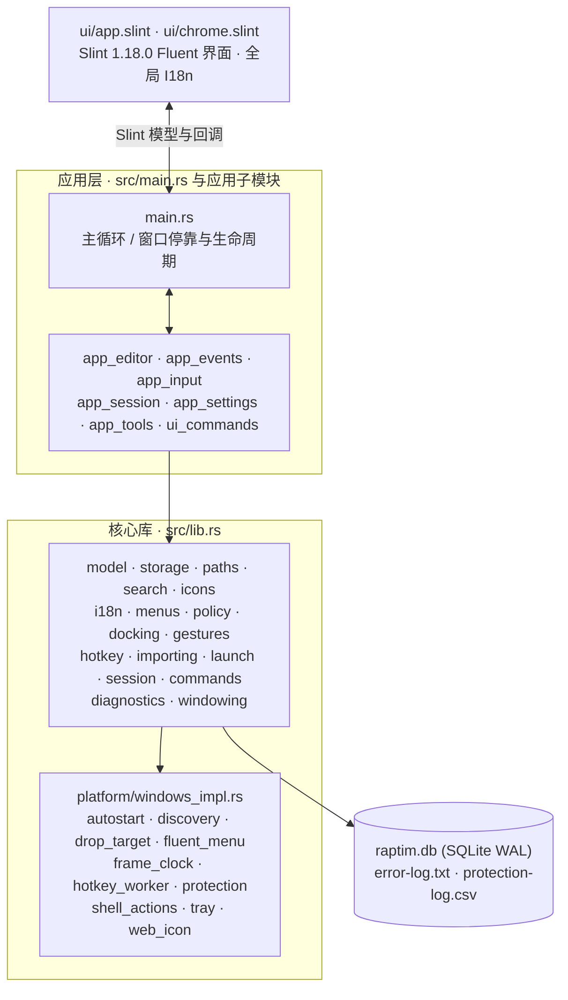
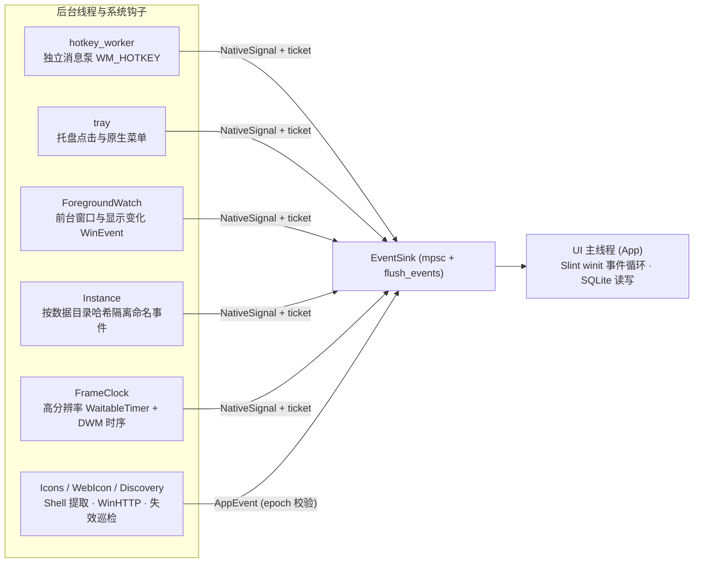
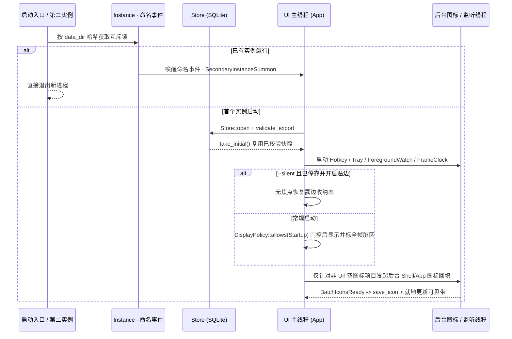

← 返回 [README](../README.md) · **简体中文** | [English](en/ARCHITECTURE.md)

# 技术架构

本文说明 Raptim 的模块分层、并发与事件模型、SQLite 存储设计、Windows 平台集成以及安全与兼容边界。操作说明见 [使用指南](USAGE.md)，构建与验证见 [开发与构建](DEVELOPMENT.md)。

- [仓库布局与模块职责](#仓库布局与模块职责)
- [线程与事件模型](#线程与事件模型)
- [核心启动与唤出时序](#核心启动与唤出时序)
- [数据存储与兼容边界](#数据存储与兼容边界)
- [菜单树与命令路由](#菜单树与命令路由)
- [显示策略与保护状态机](#显示策略与保护状态机)
- [窗口管理与渲染桥接](#窗口管理与渲染桥接)
- [单元测试分布](#单元测试分布)
- [安全与网络边界](#安全与网络边界)

## 仓库布局与模块职责

Raptim 为单 crate 工程，核心纯逻辑与平台/存储基础设施集中在库目标 `raptim`（`src/lib.rs` 统一调用 `slint::include_modules!()`），UI 装配与交互状态由二进制入口及子模块驱动。

| 路径 | 职责 |
| --- | --- |
| `src/lib.rs` | 导出 18 个核心/平台模块并集中展开 `slint::include_modules!()` |
| `src/main.rs` | 启动参数解析、单实例接入、`App` 状态机、语言热切换（`apply_language`）与 500 ms 常规巡检 |
| `src/app_editor.rs` | 添加/编辑窗口会话生命周期、图标提取防过期与未保存保护 |
| `src/app_events.rs` | 后台工作线程、原生钩子与 UI 线程之间的强类型事件分发（`AppEvent`） |
| `src/app_input.rs` | winit 事件钩子、OS 脏区消费、IME 组合态保护、拖拽防误触与键盘导航 |
| `src/app_session.rs` | 贴边保护恢复、外部拖放注册、可见带图标刷新、树形目标选择与批量整理 |
| `src/app_settings.rs` | 设置窗口按需创建、双语 `notice_items`、配置同步校验与注册表开机启动联动 |
| `src/app_tools.rs` | 已安装软件扫描导入、失效项目巡检与就地重定位 |
| `src/ui_commands.rs` | 右键/「更多」菜单上下文快照、命令路由及路径转换预览 |
| `src/i18n.rs` | `Locale::{ZhCn, EnUs}`、无锁 `ACTIVE_LOCALE`、BCP-47 标签解析与运行时 `t()` 双语文案查找 |
| `src/model.rs` | 六类 `Target`、网址归一化（`normalize_url`）、`Entry`（base64 图标字段）、`Settings` 与 `Export` |
| `src/storage.rs` | SQLite 读写、WAL 事务管理、统一 `dup_key` 查重与 JSON 导出恢复校验 |
| `src/paths.rs` | 长路径前缀剥离、相对/绝对路径解析、展示路径格式化与同盘相对转换 |
| `src/search.rs` | 基于 `pinyin`（无声调）的增量搜索索引，支持多词、全拼、首字母与驼峰匹配 |
| `src/icons.rs` | 128 px PNG 编码限幅、文件读取解码限制与后台解码缓存（上限 24 MiB） |
| `src/menus.rs` | 纯数据双语菜单树（`tree` / `tree_for_locale`）与区域归属校验（`region`） |
| `src/policy.rs` | 全屏/严格应用保护决策、`DisplayPolicy` 延迟释放状态机与单调 `ticket` |
| `src/docking.rs` | 贴边吸附几何、贴边过伸（`DOCK_OVERHANG_DIP`）、临界阻尼动画与收起外观状态 |
| `src/gestures.rs` | `DragGuard`（180 ms / 12 DIP）与 `CompositionGuard`（IME preedit 游标区判定） |
| `src/hotkey.rs` | 全局热键字符串与物理键名解析校验 |
| `src/importing.rs` | 外部拖入文件路径展开与文本网址批量构造 |
| `src/launch.rs` | 启动错误分类映射（`LaunchError`）与可重定位性判定 |
| `src/session.rs` | 本机窗口状态（`WindowState`）、搜索范围、缩放档位轮询间隔与 `NoticeQueue` |
| `src/commands.rs` | 路径转换预览与集合排序命令封装 |
| `src/diagnostics.rs` | 常开 `error-log.txt` 与按需 `protection-log.csv` 写入、路径脱敏与半段截断 |
| `src/windowing.rs` | Slint 1.18.0 软件渲染脏区刷新桥接、Tooltip 外框剥离与子窗口焦点的交还管理 |
| `src/platform/windows_impl.rs` | Win32 HWND 子类化、DWM 属性、单实例命名事件、窗口几何与子模块统一重导出 |
| `ui/app.slint` · `ui/chrome.slint` | Fluent 风格主窗、编辑窗、设置窗、公共组件及全局 `I18n`（动态切换 `Segoe UI` / `Microsoft YaHei UI`） |
| `build.rs` · `.cargo/config.toml` | 编译期注入清单/图标资源、`RAPTIM_RUST_VERSION` 及裁剪 SQLite 非必需扩展 |

## 线程与事件模型

应用采用单 UI 线程持有全部可变业务状态（`Rc<RefCell<App>>`），所有阻塞 I/O、Shell 枚举、全局消息泵与定时器均在独立后台线程运行，并通过 `EventSink`（`std::sync::mpsc::Sender<AppEvent>` + `Weak<MainWindow>::upgrade_in_event_loop`）异步投递回 UI 线程：

- **单调防过期机制**：来自平台监视的异步 `NativeSignal` 若可能产生窗体显示副作用，会携带调度当时的 `policy.ticket()`，进入 UI 线程后若保护等级或旁路状态已变更即直接丢弃。图标回填、应用图标提取与失效检查同样绑定 `data_epoch` / `icon_epoch` / `editor_generation`，防止旧会话回调污染当前界面。
- **低功耗空闲与动画调度**：
  - 主窗口、设置与编辑窗口全部隐藏且保护态为 `Normal` 时，500 ms 常规评估停止轮询（`should_poll_tick` 返回 `false`），后台完全零轮询等待系统唤醒信号。
  - 贴边收纳态使用 `collapsed_probe` 检测鼠标与停靠揭示带的距离：鼠标位于 96 px 接近带（`APPROACH_MARGIN_PX`）外时降频至 **32 ms**，进入接近带内恢复 **16 ms**；未贴边失焦淡出期间为 **8 ms**。
  - 贴边滑动动画由专用线程 `FrameClock`（高分辨率可等待定时器配合 `DwmGetCompositionTimingInfo` 计算下一次 VBlank 时刻）按单帧未确认队列推进，不阻塞 UI 线程，静止或隐藏后立即休眠。

## 核心启动与唤出时序

## 数据存储与兼容边界

业务数据与设置保存在数据目录的 `raptim.db`（开启 `WAL`、`synchronous = FULL`、`foreign_keys = ON`，`busy_timeout = 2s`）。

### SQLite 表结构

| 表名 | 字段与用途 |
| --- | --- |
| `collections` | `id`, `parent_id`（外键自引用 `ON DELETE RESTRICT`）, `name`, `position` |
| `entries` | `id`, `collection_id`, `payload`（不含图标的条目 JSON）, `position`, `icon BLOB`, `dup_key TEXT` |
| `settings` | 单行配置表（`id=1`），存储 `Settings` JSON；缺失字段按默认值补齐，拒绝未知字段 |
| `local_state` | 单行本机状态表（`id=1`），存储窗口坐标、尺寸、显示器名、贴边方向、`always_on_top` 及最后分组/分类；**不随 JSON 导出** |

### `dup_key` 统一去重与索引设计

1. **写入时物化**：`dup_key` 由 `Store::storage_key` 统一将目标按数据库目录转为绝对路径后计算 `Target::duplicate_key()`（网址保留路径与查询大小写，`Program` 包含路径、参数、工作目录、提权标志与打开方式，`Shortcut` 包含路径与打开方式），从而让相对路径与指向同一文件的绝对路径归一化到同一个键。
2. **全写入路径收敛**：新增、编辑保存、拖入、批量移动/复制、**重新定位与路径转换（`update_targets_checked`）** 以及恢复前预检均共用 `storage_key` / `slots_of` / `first_clash` 判定。
3. **普通索引而非 `UNIQUE`**：`entries_collection(collection_id, dup_key)` 刻意保持普通非唯一索引而不加 `UNIQUE` 约束。原因有两点：其一，`batch_entries` 在事务内逐行改写或交换条目时可能出现短暂合法中间态，`UNIQUE` 会抢先中止事务并把可读中文错误变成不透明回滚；其二，保证数据库中已有历史重复记录时仍能正常打开，系统遵循「只防新增、不改已有撞车对」原则。

### JSON 导出与 schema 校验边界

- 导出格式固定携带 `format_version = 2`，`Entry.icon` 使用标准 Base64 字符串（相比整数数组约 3.6 字符/字节降至 1.33），结构体均启用 `#[serde(deny_unknown_fields)]`。
- 打开数据库时校验内部 `PRAGMA user_version == 2` 与预期表结构；若遇到无法识别的库文件或非空不兼容表结构，直接返回明确中文错误并保持原文件字节零修改，不做静默迁移或覆盖。

## 菜单树与命令路由

应用上下文菜单由纯数据模块 `raptim::menus` 与平台自绘层协作完成：

- `raptim::menus::tree(kind, &MenuContext)` 根据菜单类型（`0` 标题栏「更多」、`1` 项目、`2` 分组、`3` 分类、`4` 空白区）构建菜单项树与图标字形（禁用 `DEFAULT_ICON = '\u{e8a5}'` 漏配）。
- `raptim::menus::region(kind, command)` 与 `src/ui_commands.rs` 双向核验命令号归属（`Region::{Manage, App, Item, Collection}`）；`MANAGE` 段（批量入口 `BATCH_BASE = 30` 与新增/视图/排序 `VIEW_BASE = 40..=47`）在空白右键与「更多」间共享一份构建与分发逻辑。
- `platform::fluent_menu` 使用 Win32 Owner-Draw 弹出菜单按屏幕物理坐标呈现自绘图标、浅深色主题、`Segoe UI`/`Microsoft YaHei UI` 自适应字体与悬停圆角，分隔线为 9 逻辑像素高禁用项以保证键盘和鼠标自动跳过；系统负责菜单模态跟踪与多级子菜单翻转；「Windows 原生菜单」单独经 Shell `IContextMenu` / `IContextMenu2` / `IContextMenu3` 弹出。

## 显示策略与保护状态机

所有主动或被动的显示请求都必须经过 `DisplayPolicy::allows(source, ticket)` 闸门：

- **五级优先级判断（`policy::decide`）**：
  1. `bypass == true`（本次运行暂停游戏勿扰）→ `Normal`
  2. `strict_rule == true`（前台进程命中严格保护程序列表）→ `Strict`
  3. `auxiliary_open == true`（设置/编辑/内联改名/文件对话框已打开）→ `Normal`
  4. `fullscreen_geometry` 或系统通知为 `RunningD3dFullScreen` / `PresentationMode` → `Fullscreen`
  5. 其余情况 → `Normal`
- **防抖与恢复**：保护升级立即生效并递增 `generation`（失效旧 `ticket`）；保护降级/解除需持续满足延迟（存在 `QUNS_BUSY` 信号时 3000 ms，否则 900 ms）。`ProtectionResume` 仅在进入保护前窗口本身可见、未固定且处于贴边状态时记录快照，保护解除后通过 `show_without_activation` 仅恢复边缘收纳条而绝不自动展开抢焦点。

## 窗口管理与渲染桥接

- **Slint 1.18.0 渲染桥接（`src/windowing.rs`）**：
  - 精确锁定 `slint` / `i-slint-core` / `slint-build = "=1.18.0"`。在 Windows 下，winit 软件渲染表面在窗口隐藏再重显或切换分层属性后可能复用了已清空的像素缓冲，因此通过 `WindowInner` + `mark_dirty_region` 在显示、缩放、DWM 合成/DPI 变化及 `WM_PAINT` 时同步补标逻辑脏区。
  - `prepare_tooltips` 在绘制前移除 Slint 1.18 `ToolTipImpl` 外部冗余边框矩形，使全局提示统一由 `HintSurface` 控制表面与紧凑圆角。
  - `close_child` 关闭前台子窗口时先将焦点返还主窗口并刷新重绘，后台关闭则不抢焦点也不唤出已隐藏主窗口。
- **贴边过伸与不重建框原则（`src/docking.rs`、`src/platform/windows_impl.rs`）**：
  - 贴边窗口通过 `DOCK_OVERHANG_DIP = 10.0` 将紧贴屏幕边缘一侧的窗口矩形延伸出工作区，配合 Slint `inset-left/right/top`，确保该侧系统圆角在整个停靠和滑动过程中始终位于屏幕外，而内侧保留完整系统圆角与阴影。
  - 窗口子类化 `frame_proc` 拦截 `WM_STYLECHANGING` 阻止 winit 重写覆盖 `WS_CAPTION` / `WS_EX_TOOLWINDOW`，`decorate()` 与 `topmost()` 在每次写入前检查当前 HWND 真实状态（绝不调用会抹除工具窗口属性的 `winit::set_window_level`），只在真正切换 `TOP` 层级或确实装有自定义区域时操作。
- **Shell 子 PIDL 内存安全（`src/platform/shell_actions.rs`）**：
  - Windows 11 上实测 `SHBindToParent` 输出的 `ppidlLast`（`child`）为父级 `ITEMIDLIST` 块内的偏移指针，而非独立堆分配；对其调用 `CoTaskMemFree` 会触发 `STATUS_HEAP_CORRUPTION`。代码中刻意保留父级 `Pidl` 生命周期覆盖整个上下文菜单查询过程，不对 `child` 执行单独释放。

## 单元测试分布

全仓库共在 **21 个源文件** 中维护了 **23 个 `#[cfg(test)]` 单元测试模块**，全部聚焦于不依赖真机图形窗口的纯逻辑与核心不变量：

| 范围 | 模块路径 | 核心验证点 |
| --- | --- | --- |
| 模型、路径与存储 | `src/model.rs`、`src/paths.rs`、`src/storage.rs` | 网址规范化、窗口模式参与 `dup_key`、无文件系统探测校验、跨盘与相对路径往返、条目 CRUD/查重/排序/迁移删除、JSON 导出恢复事务及冲突库兼容打开 |
| 检索、导入与启动 | `src/search.rs`、`src/icons.rs`、`src/importing.rs`、`src/launch.rs` | 全拼/首字母/驼峰/多词排序、排除文件路径、缓存 LRU 淘汰与过期解码丢弃、拖拽文件与网址分类、OS 错误码映射与可重定位性分类 |
| 菜单、策略与窗口几何 | `src/menus.rs`、`src/policy.rs`、`src/docking.rs`、`src/windowing.rs` | 五类菜单树命令号唯一性及与 `Region` 双向映射、`bypass`/`Strict`/`Fullscreen` 优先级与延迟降级、`ticket` 过期过滤、停靠过伸与阻尼动画、物理脏区逻辑坐标转换 |
| 输入、会话与诊断 | `src/gestures.rs`、`src/hotkey.rs`、`src/session.rs`、`src/diagnostics.rs`、`src/main.rs` | 180 ms/12 DIP 拖拽防误触与快滑取消、IME preedit 组合状态、热键解析规范化、搜索范围与跨平台 `NoticeQueue` 合并/截断、日志脱敏与行边界半段截断、可打印搜索字符过滤 |
| Windows 原生平台模块 | `src/platform/drop_target.rs`、`frame_clock.rs`、`shell_actions.rs`、`web_icon.rs`、`windows_impl.rs` | 模拟 `IDataObject` 解析 Unicode/`text/x-moz-url`/取消不入库、`FrameClock` 帧同步代际、`.lnk`/`.url` 往返读写、`<link>` 大小写与 PNG 缩略解析、工作目录回退、全屏矩形匹配、子窗口 Z 序及 OS 脏区合并 |

## 安全与网络边界

- **本地优先与按需联网**：除用户显式打开设置关于页点击官网外链、以及对 `Url` 类型项目执行「新增保存 / 外部拖入 / 手动刷新图标缓存」时通过 WinHTTP `GET` 抓取页面图标外，应用不建立任何网络连接；启动阶段对空图标的后台回填明确跳过 `Target::Url`，避免启动暗中联网。
- **网页抓取限制（`src/platform/web_icon.rs`）**：仅接受 `http`/`https`，严格校验 HTTP `2xx` 响应（拒绝 404 错误页或门户页返回的图片/HTML），页面大小上限 256 KiB、图片下载上限 1 MiB、入库上限 200 KiB、单网址总预算 10 秒、尺寸限制 16 px – 4096 px（输出缩放至最长边 ≤ 128 px PNG）。
- **路径输入与日志脱敏**：`Target::validate()` 拒绝空字符、超长字符串及非 http(s) 协议或相对格式路径；日志模块（`src/diagnostics.rs`）写入 `error-log.txt` 与 `protection-log.csv` 前自动将用户主目录及数据目录替换为 `<用户>` 与 `<数据目录>`。
