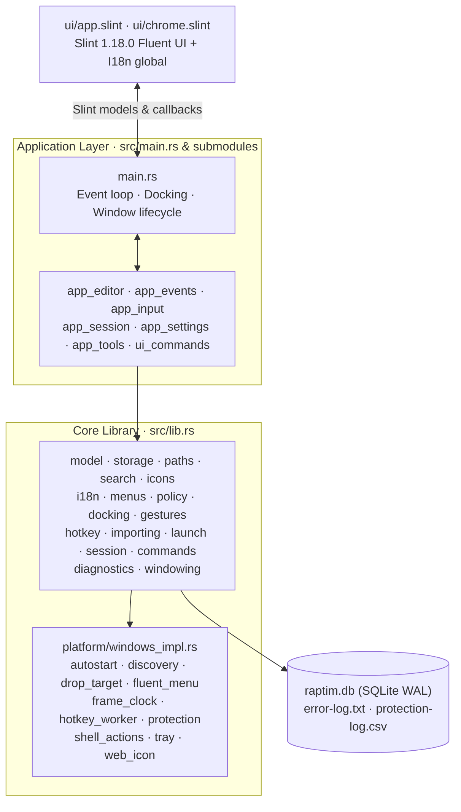
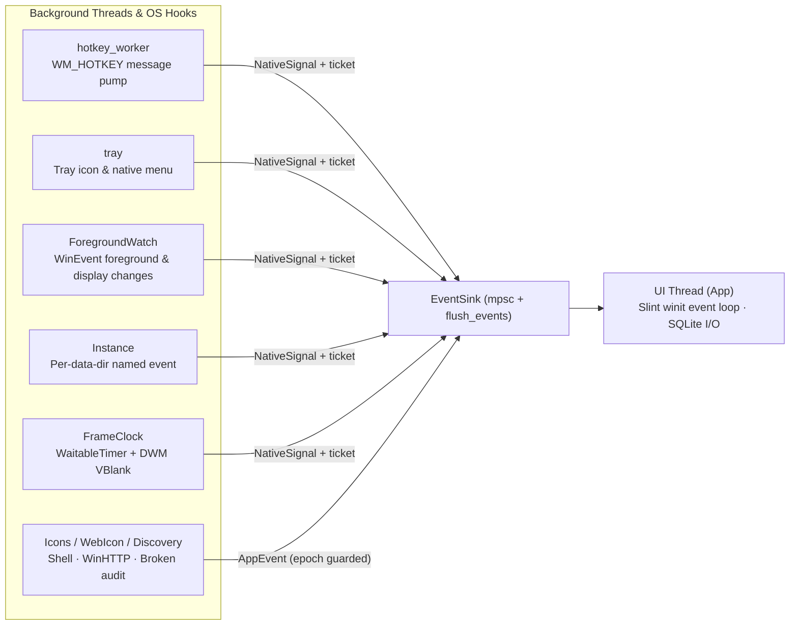
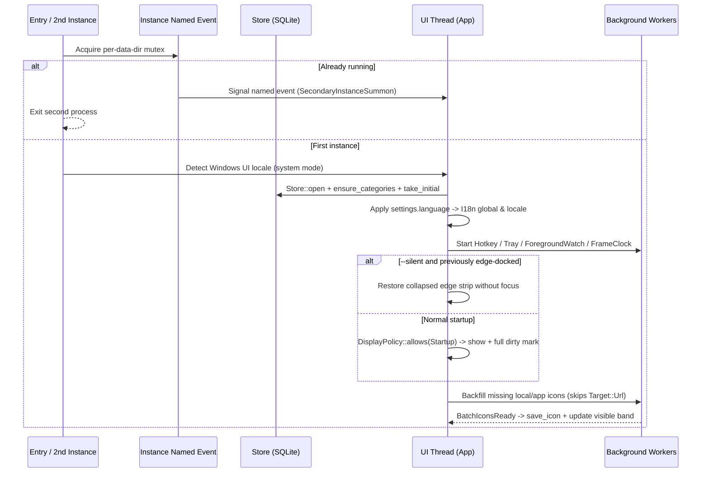

← Back to [README](../../README.en.md) · [简体中文](../ARCHITECTURE.md) | **English**

# Technical Architecture

This document explains Raptim's module layers, concurrency and event model, SQLite storage layout, Windows integration, and safety/compatibility boundaries. For day-to-day usage see [Usage Guide](USAGE.md); for build and verify instructions see [Development & Build](DEVELOPMENT.md).

- [Repository Layout & Module Roles](#repository-layout--module-roles)
- [Threading & Event Model](#threading--event-model)
- [Startup & Summon Sequence](#startup--summon-sequence)
- [Data Storage & Compatibility Boundaries](#data-storage--compatibility-boundaries)
- [Context Menus & Command Routing](#context-menus--command-routing)
- [Display Policy & Protection State Machine](#display-policy--protection-state-machine)
- [Windowing & Software Renderer Bridge](#windowing--software-renderer-bridge)
- [Unit Test Distribution](#unit-test-distribution)
- [Security & Network Boundaries](#security--network-boundaries)

## Repository Layout & Module Roles

Raptim is a single-crate workspace where pure core logic and platform/storage infrastructure live in library `raptim` (`src/lib.rs` centralizes `slint::include_modules!()`), while UI orchestration and state wiring live in the binary target and its submodules.

| Path | Responsibility |
| --- | --- |
| `src/lib.rs` | Exports core/platform modules and expands `slint::include_modules!()` once |
| `src/main.rs` | CLI parsing, single-instance lock, `App` state machine, Slint loop, `apply_language`, and 500 ms periodic checks |
| `src/app_editor.rs` | Add/Edit window session, async icon extraction generation checks, and unsaved-changes guard |
| `src/app_events.rs` | Strongly typed `AppEvent` dispatch between workers, native hooks, and UI thread |
| `src/app_input.rs` | `winit` event hook, OS dirty-rect consumption, IME composition guard, drag guard, and keyboard shortcuts |
| `src/app_session.rs` | Protection edge resume, OLE drop-target setup, visible icon refresh, tree pickers, and batch ops |
| `src/app_settings.rs` | Lazy `SettingsWindow` creation, bilingual `notice_items`, settings sync/validation, and Windows autostart sync |
| `src/app_tools.rs` | Installed software discovery/import, broken-target checker, and in-place relocation |
| `src/ui_commands.rs` | Context/More menu snapshot building, command dispatch, and path-conversion preview |
| `src/i18n.rs` | `Locale::{ZhCn, EnUs}`, lock-free `ACTIVE_LOCALE`, BCP-47 tag parsing, and runtime `t()` helpers |
| `src/model.rs` | Six `Target` variants, URL normalization, `Entry` (Base64 icons in JSON), `Settings`, and `Export` |
| `src/storage.rs` | SQLite access, WAL transactions, unified `dup_key` checking, and JSON export/restore validation |
| `src/paths.rs` | Long-path prefix stripping, relative/absolute resolution, tooltip formatting, and same-drive conversion |
| `src/search.rs` | Incremental search index powered by `pinyin` (tone-less) with multi-keyword, Pinyin, initials, and camelCase scoring |
| `src/icons.rs` | `STORE_MAX = 128` PNG encoder, bounded image reader, and 24 MiB background LRU decode cache |
| `src/menus.rs` | Pure-data localized menu trees (`tree` / `tree_for_locale`) and region validation (`region`) |
| `src/policy.rs` | Fullscreen/strict app protection decision logic, debounced `DisplayPolicy`, and monotonic `ticket` |
| `src/docking.rs` | Screen-edge snapping, overhang (`DOCK_OVERHANG_DIP`), critically damped animation, and collapse appearance |
| `src/gestures.rs` | `DragGuard` (180 ms / 12 DIP) and `CompositionGuard` (IME preedit + cursor area) |
| `src/hotkey.rs` | Global shortcut parser and canonical formatter |
| `src/importing.rs` | File path classification and browser URL/URI-list parsing |
| `src/launch.rs` | OS launch error classification (`LaunchError`) and relocatability checks |
| `src/session.rs` | Per-machine `WindowState`, search scope, polling intervals, and `NoticeQueue` |
| `src/commands.rs` | Batch path-conversion preview and collection reorder helpers |
| `src/diagnostics.rs` | Always-on `error-log.txt` and opt-in `protection-log.csv` with path redaction and half-log truncation |
| `src/windowing.rs` | Slint 1.18.0 software renderer dirty-rect bridge, `ToolTipImpl` border strip, and child focus return |
| `src/platform/windows_impl.rs` | Win32 HWND subclassing, DWM cloak/rounded-corner attributes, registry locale detection, single-instance event, and platform re-exports |
| `ui/app.slint` · `ui/chrome.slint` | Fluent-styled Main, Editor, and Settings windows plus `I18n` global (`Segoe UI` / `Microsoft YaHei UI`) |
| `build.rs` · `.cargo/config.toml` | Manifest/icon embedding, `RAPTIM_RUST_VERSION`, and SQLite compile-time `CFLAGS` trimming |

## Threading & Event Model

A single UI thread owns all mutable state (`Rc<RefCell<App>>`). Blocking Shell calls, network requests, Win32 message pumps, and high-resolution timers run on dedicated worker threads and post back via `EventSink` (`std::sync::mpsc::Sender<AppEvent>` + `Weak<MainWindow>::upgrade_in_event_loop`):

- **Monotonic staleness guards**: Async `NativeSignal`s carry the `policy.ticket()` captured when scheduled; if protection or bypass state changed before delivery, visibility-mutating signals are dropped. Background icon fetches and broken checks likewise check `data_epoch` / `icon_epoch` / `editor_generation`.
- **Zero-polling idle & adaptive timers**:
  - When all windows are hidden and protection is `Normal`, 500 ms periodic checks stop (`should_poll_tick() == false`) and only OS wakeups run.
  - While edge-hidden, pointer polling ticks at **32 ms** outside `APPROACH_MARGIN_PX` (96 px) and **16 ms** near the strip; focus-loss fade ticks at **8 ms**; `FrameClock` advances slides in sync with DWM composition timing.

## Startup & Summon Sequence

## Data Storage & Compatibility Boundaries

Data and settings live in `<data_dir>/raptim.db` (`WAL` mode, `synchronous = FULL`, `foreign_keys = ON`, `busy_timeout = 2s`).

### SQLite Schema

| Table | Columns & Role |
| --- | --- |
| `collections` | `id`, `parent_id` (self-referencing FK `ON DELETE RESTRICT`), `name`, `position` |
| `entries` | `id`, `collection_id`, `payload` (entry JSON without icon bytes), `position`, `icon BLOB`, `dup_key TEXT` |
| `settings` | Single-row config (`id=1`), JSON `Settings` (including optional `language: u8`); missing fields default safely, unknown fields rejected |
| `local_state` | Single-row host state (`id=1`): window geometry, display name, dock edge, `always_on_top`, last group/category; **excluded from JSON exports** |

### Unified `dup_key` & Indexing

1. **Materialized on write**: `Store::storage_key` resolves relative paths against the DB directory before computing `Target::duplicate_key()` (preserving URL path/query case; including arguments/working dir/elevation/show mode for `Program` and show mode for `Shortcut`).
2. **Single shared check**: Add, edit save, drag-drop, batch move/copy, **relocate & path conversion (`update_targets_checked`)**, and restore preflight all share `storage_key` / `slots_of` / `first_clash`.
3. **Non-unique index**: `entries_collection(collection_id, dup_key)` is intentionally a regular index rather than `UNIQUE` so transactional row swaps inside `batch_entries` don't abort mid-transaction and databases containing pre-existing duplicates still open normally ("prevent new clashes, never break opening old data").

### JSON Export & Schema Versioning

- Exports carry `format_version = 2` with Base64-encoded `Entry.icon` strings and `#[serde(deny_unknown_fields)]`.
- Opening a DB checks `PRAGMA user_version == 2` and expected table layouts; incompatible files return an error without migrating, overwriting, or modifying bytes on disk.

## Context Menus & Command Routing

- `raptim::menus` builds localized pure-data menu trees (`0` More menu, `1` Entry, `2` Group, `3` Category, `4` Blank area) with explicit Fluent glyphs (never falling back to default icon glyphs).
- `raptim::menus::region(kind, command)` cross-checks command IDs against `src/ui_commands.rs`. Blank-area manage actions (`BATCH_BASE = 30`, `VIEW_BASE = 40..=47`) are reused identically in the title-bar More menu.
- `platform::fluent_menu` renders Win32 owner-drawn popup menus at physical screen coordinates using `Segoe UI` (English) or `Microsoft YaHei UI` (Simplified Chinese) and Light/Dark theme colors; Windows Native Shell menu runs via `IContextMenu` / `IContextMenu2` / `IContextMenu3`.

## Display Policy & Protection State Machine

Every show or summon entry passes through `DisplayPolicy::allows(source, ticket)`:

1. `bypass == true` (session Game DND bypass) → `Normal`
2. `strict_rule == true` (foreground exe matches strict-protected list) → `Strict`
3. `auxiliary_open == true` (Settings, Editor, inline input, or file dialog open) → `Normal`
4. `fullscreen_geometry` or `SHQueryUserNotificationState` (`RunningD3dFullScreen` / `PresentationMode`) → `Fullscreen`
5. Otherwise → `Normal`

Protection escalates immediately (bumping `generation` and invalidating stale `ticket`s) and debounces relaxation (3000 ms when `QUNS_BUSY` is active, 900 ms otherwise). `ProtectionResume` only restores an unpinned, previously visible docked window back to its collapsed edge strip via `show_without_activation`.

## Windowing & Software Renderer Bridge

- **Slint 1.18.0 (`src/windowing.rs`)**: `slint`, `i-slint-core`, and `slint-build` stay strictly pinned to `=1.18.0`. Because winit's software renderer on Windows may reuse stale buffers across hide/show and attribute transitions, `WindowInner::mark_dirty_region` marks logical dirty bounds on show, DPI/scale/DWM changes, and `WM_PAINT`. `prepare_tooltips` removes outer border artifacts on `ToolTipImpl`, and `close_child` restores focus to the main window only when closing an active child window.
- **Overhang docking & frame preservation (`src/docking.rs`, `src/platform/windows_impl.rs`)**: Docked edges extend off-screen by `DOCK_OVERHANG_DIP = 10.0` paired with Slint insets to hide edge-side OS corner rounding. `WM_STYLECHANGING` stops winit from stripping `WS_EX_TOOLWINDOW`, and neither `decorate()` nor `topmost()` ever calls `winit::set_window_level`; every native write checks current HWND state first.
- **Shell PIDL lifetime (`src/platform/shell_actions.rs`)**: `SHBindToParent`'s `ppidlLast` is an interior pointer inside the parent `ITEMIDLIST`; Raptim never passes `child` to `CoTaskMemFree` and keeps the parent `Pidl` alive until `GetUIObjectOf` finishes.

## Unit Test Distribution

Across the workspace, unit tests live in inline `#[cfg(test)]` modules focused on pure logic and core data invariants that require no real desktop windows:

| Scope | Module paths | Key verified invariants |
| --- | --- | --- |
| Models, paths & storage | `src/model.rs`, `src/paths.rs`, `src/storage.rs` | URL normalization, show-mode in `dup_key`, non-I/O target validation, cross-drive & relative path roundtrips, CRUD/clash checks/reordering/migration delete, transactional JSON export/restore, legacy duplicate DB loading |
| Search, import & launch | `src/search.rs`, `src/icons.rs`, `src/importing.rs`, `src/launch.rs` | Pinyin/initials/camelCase/multi-word ranking, path exclusion, 24 MiB LRU eviction & stale decode rejection, file/URL classification, OS error mapping & relocatability |
| i18n, menus, policy & geometry | `src/i18n.rs`, `src/menus.rs`, `src/policy.rs`, `src/docking.rs`, `src/windowing.rs` | BCP-47 locale parsing & non-mutating resolution, bilingual menu uniqueness & `region()` routing, `bypass`/`Strict`/`Fullscreen` precedence & debounce, stale `ticket` drop, overhang docking & damping, physical dirty-rect conversion |
| Input, session & diagnostics | `src/gestures.rs`, `src/hotkey.rs`, `src/session.rs`, `src/diagnostics.rs`, `src/main.rs` | 180 ms / 12 DIP drag guard & fast-flick cancellation, IME composition guard, hotkey validation, search scopes, polling intervals & `NoticeQueue`, log redaction & half-log truncation, printable-char search filter |
| Windows native & preview tools | `src/platform/{drop_target,frame_clock,shell_actions,web_icon}.rs`, `src/platform/windows_impl.rs`, `examples/ui_preview/{main,compose,scenes}.rs` | Mock `IDataObject` parsing, `FrameClock` idle/generation checks, `.lnk`/`.url` roundtrip, `<link>` case-insensitive & HTTP `2xx` checks, working-dir fallback, fullscreen rect matching, Z-order/dirty rects, preview CLI & frame composition |

## Security & Network Boundaries

- **Offline-first**: Beyond explicit user link clicks in About, the only outbound requests are `Target::Url` favicon fetches on add/drop/manual icon refresh via WinHTTP `GET`. Startup icon backfill explicitly skips `Target::Url`.
- **Web icon limits (`src/platform/web_icon.rs`)**: Accepts only `http`/`https`, enforces HTTP `2xx`, caps HTML at 256 KiB, image download at 1 MiB, stored icon at 200 KiB, timeout at 10 s per URL, and dimensions within 16–4096 px (scaled to ≤ 128 px PNG).
- **Redacted logs (`src/diagnostics.rs`)**: Both `error-log.txt` and `protection-log.csv` automatically redact user home and data directory prefixes with `<用户>` / `<数据目录>`.
